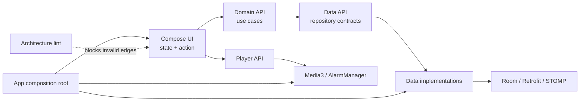
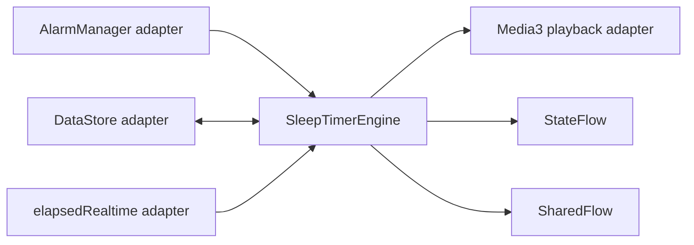

# Sollang Android Engineering

[](https://github.com/o06o/sollang-android-engineering/actions/workflows/ci.yml)
[](https://kotlinlang.org/)
[](LICENSE)

출시를 앞둔 웰니스 앱 **Sollang**(스토어 심사 중)에서 다룬 Android 설계 문제를 공개 가능한 형태로 정리한
엔지니어링 포트폴리오입니다.

제품 저장소 전체를 복제한 프로젝트가 아닙니다. 서버 주소, 인증 정보, 디자인 자산과 제품 코드는
포함하지 않았고, 핵심 신뢰성 로직은 독립적으로 실행되는 작은 Kotlin 샘플로 다시 작성했습니다.

## 5분 리뷰 경로

1. [`SleepTimerEngine`](src/main/kotlin/dev/o06o/sollang/timer/SleepTimerEngine.kt) — 타이머 복구와 중복 만료 방지
2. [`SleepTimerEngineTest`](src/test/kotlin/dev/o06o/sollang/timer/SleepTimerEngineTest.kt) — 교체·중복 alarm·clock reset 회귀 테스트
3. [Compose 재구성·렌더링 성능 트러블슈팅](docs/case-studies/compose-runtime-performance.md)

더 보기:
[백그라운드 재생](docs/case-studies/playback-and-sleep-timer.md) ·
[실시간 채팅](docs/case-studies/realtime-chat-reliability.md) ·
[멀티모듈 경계](docs/case-studies/architecture-guardrails.md) ·
[Git·CI/CD](docs/case-studies/git-branch-and-cicd.md) ·
[Amplitude 제품 분석](docs/case-studies/product-analytics-with-amplitude.md) ·
[AI 활용 Android → iOS](docs/ai-assisted-ios-development.md)

## 프로젝트에서 다룬 문제

| 영역 | 기술적 문제 | 선택 |
|---|---|---|
| 재생 | 앱·process 상태와 독립적인 재생 | Media3 `MediaSessionService` |
| 수면 타이머 | 화면 종료, process 재생성, 중복 alarm | monotonic clock + 영속 상태 + idempotent expiration |
| 채팅 | STOMP 연결 끊김, 무응답, 재연결 중 중복 응답 | lifecycle-aware reconnect + timeout + deduplication |
| 상태 관리 | Compose 화면과 비즈니스 상태 결합 | state/action 경계 + `StateFlow`/`SharedFlow` |
| Compose 성능 | 고빈도 state와 animation이 넓은 UI를 무효화 | state 분리 + draw/layout 단계에서 늦게 읽기 |
| 아키텍처 | 모듈 규칙이 문서에서만 존재 | convention plugin + architecture lint |
| 배포 | 승인 뒤 branch HEAD가 달라지거나 검증 실패 커밋이 배포될 위험 | Actions gate + Slack 승인 + Jenkins의 `branch@sha` 배포 |
| 제품 분석 | 화면 구조와 SDK에 종속된 이벤트, 개인정보 과수집 | SDK 독립 계약 + Amplitude 환경 분리 + 최소 수집 |
| 크로스 플랫폼 | Android 동작을 iOS에 단순 복사할 위험 | 제품 계약 공유 + 플랫폼별 구현과 검증 |

## 구조



핵심은 모듈 수가 아니라 **의존 방향을 왜 나눴고 어떤 비용을 감수했는지**입니다. 실제 프로젝트의
모듈 경계와 줄일 수 있는 부분은 [architecture guardrails case study](docs/case-studies/architecture-guardrails.md)에
함께 기록했습니다.

## 공개 샘플의 설계

`SleepTimerEngine`은 Android framework에 직접 의존하지 않는 결정 로직입니다.



- 저장된 timer id가 현재 id와 같을 때만 만료를 소비합니다.
- alarm과 화면 countdown이 동시에 만료를 감지해도 재생은 한 번만 멈춥니다.
- 새 타이머가 이전 타이머를 교체하면 늦게 도착한 이전 alarm은 무시됩니다.
- monotonic clock이 초기화된 상태에서는 이전 부팅의 타이머를 잘못 복구하지 않습니다.
- Android API는 adapter로 격리해 결정 로직을 JVM 테스트로 검증합니다.

채팅 샘플은 서버에 correlation id가 없다는 제약을 숨기지 않습니다. 서버 등록 시각과 본문으로만
안전하게 식별할 수 있는 응답을 중복 제거하고, 등록 시각이 없으면 데이터 유실을 피하기 위해 그대로
전달합니다.

## 실행

요구 사항: JDK 17

```bash
./gradlew test
```

CI도 같은 명령을 실행합니다.

## AI 활용 원칙

AI는 Android 코드 탐색, 플랫폼 계약 비교, 반복 구현, 테스트 초안과 문서 동기화에 사용했습니다.
제품 결정, 공개 API 경계, 보안 판단, 플랫폼 차이와 최종 검증은 사람이 책임졌습니다.

구체적인 작업 방식과 한계는 [AI-assisted iOS development](docs/ai-assisted-ios-development.md)에 정리했습니다.

## 공개 범위

- 이 저장소의 샘플 코드는 포트폴리오를 위해 독립적으로 단순화한 코드입니다.
- 실제 제품의 비공개 소스, API endpoint, credential, 사용자 데이터와 디자인 자산은 포함하지 않습니다.
- 정량적인 성능 개선 수치는 측정 자료가 없는 경우 작성하지 않았습니다.

