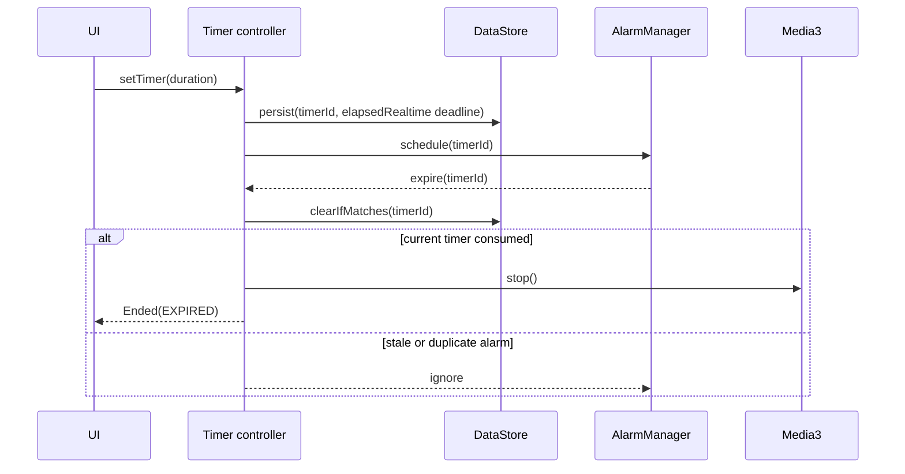

# 백그라운드 재생과 수면 타이머

## 문제

수면 사운드 앱에서 타이머는 화면에 보이는 countdown이 아닙니다. 사용자가 앱을 background로 보내거나
process가 재생성돼도 정해진 시점에 재생이 끝나야 합니다. 반대로 화면의 countdown과 OS alarm이 동시에
만료를 감지하더라도 재생 정지·로그 종료·알림이 두 번 실행되면 안 됩니다.

## 제약

- Android는 background 실행과 exact alarm을 제한합니다.
- wall clock은 사용자가 바꿀 수 있어 경과 시간 계산에 적합하지 않습니다.
- `BroadcastReceiver`와 앱 process의 countdown이 같은 만료를 전달할 수 있습니다.
- 타이머를 교체한 직후 이전 alarm이 늦게 도착할 수 있습니다.
- 재생 종료와 분석 로그 종료는 같은 timer identity를 기준으로 맞아야 합니다.

## 선택

1. 타이머마다 고유 id를 부여합니다.
2. 시작·종료 시각은 monotonic clock 기준으로 저장합니다.
3. 영속 저장소의 현재 id와 요청 id가 일치할 때만 만료를 소비합니다.
4. 소비·재생 정지 경계는 mutex로 직렬화합니다.
5. 앱이 다시 만들어지면 저장된 상태를 읽어 alarm과 표시 상태를 복구합니다.
6. 기기 재부팅으로 monotonic clock이 초기화됐으면 이전 타이머를 폐기합니다.

## 유지하는 불변식

- 하나의 timer id는 최대 한 번만 종료됩니다.
- 이전 타이머의 alarm은 새 타이머를 종료할 수 없습니다.
- 자연 만료와 사용자 취소는 별도 이벤트입니다.
- 자연 만료는 pause가 아니라 stop입니다. 이후 재생은 새 세션입니다.
- 알림 설정은 알림 표시만 제어하고 재생 정지 여부는 바꾸지 않습니다.

## 테스트

공개 샘플은 다음 회귀 조건을 실행합니다.

- 저장된 타이머를 복구하고 남은 초를 올림 처리
- 동일 alarm의 중복 전달에서 재생을 한 번만 정지
- 교체된 이전 timer id의 늦은 alarm 무시
- monotonic clock 초기화 시 잘못된 타이머 폐기

코드: [`SleepTimerEngineTest`](../../src/test/kotlin/dev/o06o/sollang/timer/SleepTimerEngineTest.kt)

## 검토한 대안

### 화면 coroutine만 사용

구현은 작지만 화면·process 생명주기에 묶이므로 제외했습니다.

### wall clock deadline 저장

재부팅 후에도 해석하기 쉽지만 사용자 시간 변경에 영향을 받습니다. 이 제품에서는 같은 부팅 세션의
정확한 경과 시간을 우선했고, 재부팅 전 타이머는 폐기하는 정책을 선택했습니다.

### alarm만 사용

OS 만료에는 충분하지만 화면에 남은 시간을 표시하고 즉시 취소·교체하는 상태 모델이 별도로 필요합니다.
alarm과 앱 상태가 같은 영속 timer identity를 공유하도록 구성했습니다.

## 남은 위험

- exact alarm 권한이 없는 기기의 실제 지연 시간은 실기기 측정이 필요합니다.
- 제조사별 background 제한은 단위 테스트만으로 검증할 수 없습니다.
- 공개 샘플은 Android adapter 대신 결정 로직만 포함합니다.

