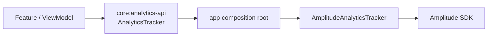

# Amplitude 기반 제품 분석 설계

## 문제

월간 통계 화면을 제공하는 것과 제품이 실제로 어떻게 사용되는지 판단하는 것은 다른 문제였습니다.
화면 조회 수만으로는 사용자가 일기를 먼저 쓰는지, 사운드를 먼저 재생하는지, 일기 완료가 재생과
반복 사용으로 이어지는지 알 수 없습니다.

Sollang에서는 Amplitude를 단순 SDK 연동이 아니라 **행동 이벤트 계약**으로 도입했습니다. UI 구조가
바뀌어도 핵심 지표가 이어지고, 분석 장애가 사용자 기능을 실패시키지 않도록 경계를 설계했습니다.

## SDK를 기능에서 격리

Feature는 Amplitude 클래스나 property map을 직접 만들지 않습니다. `core:analytics-api`의 닫힌
`AnalyticsEvent`와 `AnalyticsTracker`만 사용하고, 앱 모듈이 이를 Amplitude 이벤트로 변환합니다.

이 경계로 얻은 효과는 다음과 같습니다.

- 이벤트 이름과 필수 property를 컴파일 가능한 계약으로 관리
- Feature 테스트에서 외부 SDK 없이 fake tracker 사용
- SDK 교체·비활성화가 화면과 도메인 코드로 전파되는 범위 축소
- 이벤트 전송 예외가 로그인·일기·재생·알림 동작을 중단하지 않는 best-effort 처리

## 측정하려는 질문

| 제품 질문 | 대표 이벤트·분석 |
|---|---|
| 사용자는 일기와 사운드 중 무엇을 먼저 쓰는가 | 세션 첫 `diary_start`와 `sound_play` 비교 |
| 일기 경험이 사운드 이용으로 이어지는가 | `diary_start` → `diary_complete` → `sound_play` funnel |
| AI Mix와 사용자 Mix 중 무엇을 이용하는가 | `sound_play.mix_type`, `mix_created.mix_type` |
| 수면 타이머가 실제 청취로 이어지는가 | 설정 시간, 만료 여부, 실제 재생 시간 비율 |
| 게스트가 소셜 계정으로 전환하는가 | `guest_to_social_complete`와 로그인 유형 |
| 알림이 앱 진입으로 연결되는가 | 같은 `notification_id`의 displayed → open |
| 어떤 화면에 도달하는가 | 고정된 `screen_name`의 `screen_view` |

평균만 보면 긴 세션 몇 개가 결과를 왜곡할 수 있어 시간·횟수는 중앙값과 분포를 함께 보는 것을
원칙으로 정했습니다.

## 이벤트 계약

이벤트는 세션, 일기, 재생, Mix, 타이머, 알림의 사용자 행동을 기준으로 나눴습니다.

- 세션·화면: `app_session_start`, `screen_view`
- 일기: `diary_start`, `chat_step_enter`, `diary_complete`
- 재생·Mix: `sound_play`, `sound_session_end`, `mix_created`
- 타이머: `timer_set`, `timer_session_end`
- 계정·알림: `guest_to_social_complete`, `notification_displayed`, `notification_open`

이름과 property는 기본적으로 snake_case를 사용하고, 화면 이름은 route parameter를 제거한 고정값으로
관리합니다. Compose recomposition, 네트워크 재시도와 재연결이 같은 논리 이벤트를 중복 기록하지 않도록
“UI가 보인 시점”이 아니라 서버 생성 성공, 실제 재생 진입, 유효한 타이머 예약처럼 명확한 경계에서
기록합니다.

## 사용자·세션 식별

- 활성 사용자 ID가 있을 때만 이벤트를 전송합니다.
- 게스트도 서버에서 발급한 ID를 사용하고 로그인 유형을 모든 이벤트에 포함합니다.
- 게스트에서 소셜 계정으로 전환해 ID가 바뀌면 임의로 두 사용자를 병합하지 않습니다. 새 소셜 사용자에
  전환 완료 이벤트를 남겨 전환율만 연결합니다.
- 로그아웃·탈퇴 또는 활성 사용자 부재 시 SDK identity를 초기화하고 수집을 중단합니다.
- 최초 실행 또는 30분 이상 background에 있다가 복귀했을 때만 새 세션 시작 이벤트를 기록합니다.
- 자동 화면·요소·딥링크·세션 이벤트는 끄고 제품 계약에 정의한 이벤트만 수동으로 기록합니다.

명시적인 ID 연속성을 포기한 이유는 잘못된 사용자 병합이 분석 정확성과 개인정보 경계를 더 크게
훼손할 수 있기 때문입니다.

## 환경과 개인정보 분리

DEV와 PROD는 서로 다른 Amplitude 프로젝트와 API key를 사용합니다. 개발 중 발생한 이벤트가 운영
지표를 오염시키지 않으며, key는 flavor별 BuildConfig로 주입합니다.

수집하지 않는 정보도 먼저 정했습니다.

- 일기·채팅 내용과 AI 응답
- 감정 점수, 닉네임, 이메일
- 인증 token과 API 요청·응답 본문
- 민감 URL과 Session Replay

사용자 ID와 채팅방·재생·타이머·알림 ID는 명세에 정의한 funnel 연결에만 사용합니다. Firebase는
Crashlytics와 FCM 용도로 유지하지만 Firebase Analytics/GA4에는 같은 이벤트를 이중 전송하지 않습니다.

## 신뢰성과 검증

Amplitude mapping 단위 테스트는 다음을 확인합니다.

- 앱이 30분 이상 background에 있었을 때만 세션이 갱신되는지
- 로그아웃 사용자와 빈 ID가 수집 대상에서 제외되는지
- 알 수 없는 로그인 유형이 안전한 기본값으로 변환되는지
- sealed event가 명세의 이벤트 이름과 property로 매핑되는지
- 게스트→소셜 전환 이벤트가 실제 소셜 provider에서만 생성되는지

관련 단위 테스트와 architecture/convention lint를 통과시켰고 DEV 실기기에서 Amplitude 수집을
확인했습니다. 이벤트별 전체 funnel의 운영 데이터 품질은 배포 후 지속적으로 검증해야 하는 영역이며,
SDK 전송 성공 자체를 제품 지표의 정확성과 동일하게 보지 않습니다.

## 결과와 한계

- 화면 코드에서 분석 SDK와 문자열 property 조립을 제거했습니다.
- 제품 질문, 이벤트 발생 조건, 개인정보 제외 기준을 하나의 계약으로 연결했습니다.
- 분석 실패를 사용자 기능 실패와 분리했습니다.
- 현재 데이터 리전은 Android SDK 기본 US이며, 운영 정책에서 EU 리전이 필요하면 endpoint를 배포 전에
  변경해야 합니다.
- 게스트와 소셜 사용자를 병합하지 않으므로 개인 단위의 완전한 전환 전후 여정 대신 명시적 전환
  이벤트로 지표를 계산합니다.

이 사례의 핵심은 “Amplitude를 붙였다”가 아니라, **어떤 제품 질문을 어떤 이벤트로 답하고 무엇을
수집하지 않을지까지 코드 계약으로 만든 것**입니다.

