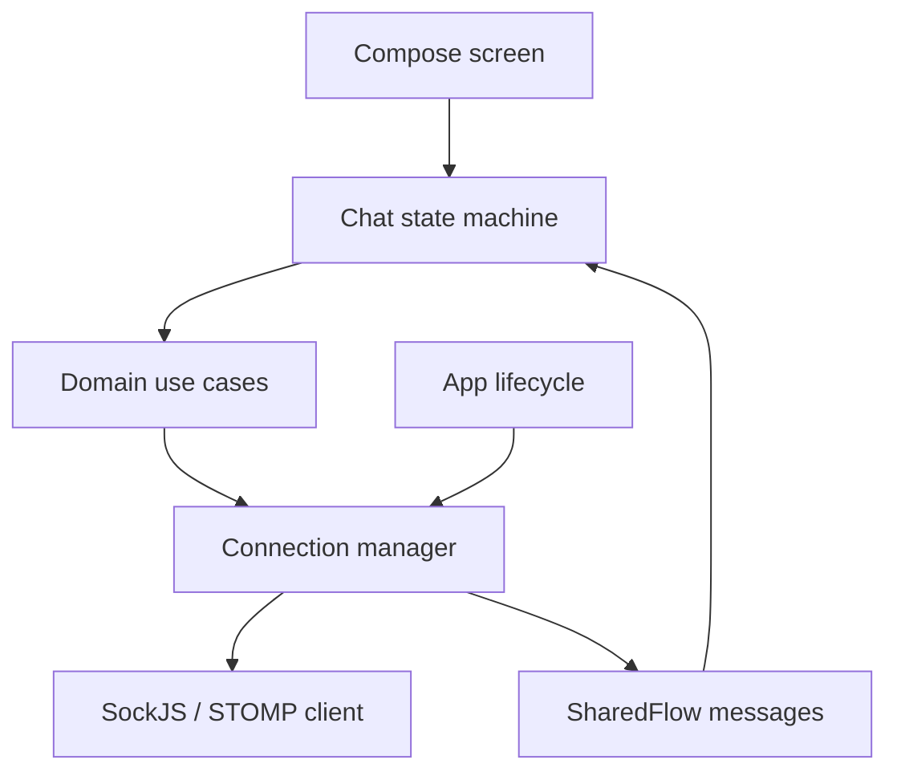

# 실시간 채팅 신뢰성

## 문제

AI 채팅은 REST 요청 하나로 끝나지 않습니다. SockJS/STOMP 연결, 전송, 부분 응답, 종료 frame이 이어지고
foreground/background 전환이나 네트워크 단절이 중간에 발생합니다. 연결 객체가 존재한다는 사실과 사용자가
응답을 받을 수 있다는 사실도 같지 않습니다.

실제 QA에서 중요했던 문제는 다음과 같았습니다.

- STOMP `CONNECTED` 이전에 메시지를 전송
- 서버가 응답도 오류도 보내지 않아 로딩 상태가 끝나지 않음
- 재연결 경계에서 같은 응답이 다시 도착
- background에서도 재연결 loop가 유지됨
- 종료 frame 전송 실패인데 화면부터 닫힘

## 책임 분리

- 연결 관리자는 활성 채팅방, foreground 여부와 재연결을 소유합니다.
- 화면 상태는 전송 중, 응답 대기, 실패, 감정 분석을 구분합니다.
- 연결이 없으면 재연결하고 `CONNECTED`를 제한 시간 동안 기다린 뒤 한 번 더 전송합니다.
- 사용자 대기 작업은 REST와 같은 timeout 기준을 공유합니다.
- background에서는 연결을 멈추고 foreground에서 필요한 경우 다시 연결합니다.

## 중복 응답

서버 응답에 요청 correlation id가 없어 완전한 중복 판별은 불가능했습니다. 확인 가능한 서버 등록 시각과
본문의 조합만 fingerprint로 사용했습니다.

- fingerprint가 같으면 두 번째 응답을 무시합니다.
- 등록 시각이 없으면 중복일 수 있어도 전달합니다. 잘못 제거해 데이터가 사라지는 것보다 안전합니다.
- fingerprint history는 메모리 사용이 계속 늘지 않도록 제한합니다.

공개 코드: [`ChatResponseDeduplicator`](../../src/main/kotlin/dev/o06o/sollang/chat/ChatResponseDeduplicator.kt)

## 실패를 사용자 상태로 바꾸기

| 실패 | 사용자 결과 |
|---|---|
| 연결 실패 | 재연결 후 1회 재전송, 실패 시 해당 메시지만 실패 표시 |
| 응답 시작 timeout | 전송 실패로 전환하고 재시도 가능 |
| STOMP `ERROR` | 오류 표시 후 연결 재시도 |
| 종료 frame 실패 | 채팅 화면에 남고 종료 실패 안내 |
| background 전환 | 연결 정지, foreground 복귀 시 재연결 |

무한 spinner를 네트워크 문제가 아닌 상태 모델의 결함으로 보고, 모든 대기 상태에 성공·실패·취소 종료 경로를
정의했습니다.

## 트레이드오프

- 현재 재연결 간격은 고정입니다. 단순하고 빠르지만 서버 장애가 길면 부하를 키울 수 있습니다.
- 지수 backoff는 필요성이 측정되면 Android와 iOS에 함께 적용할 후속 항목으로 남겼습니다.
- correlation id가 계약에 추가되면 timestamp/body fingerprint를 제거하는 것이 맞습니다.
- 단위 테스트는 상태 전환을 검증하지만 이동통신망 전환과 장시간 background 복귀는 실기기 검증이 필요합니다.

